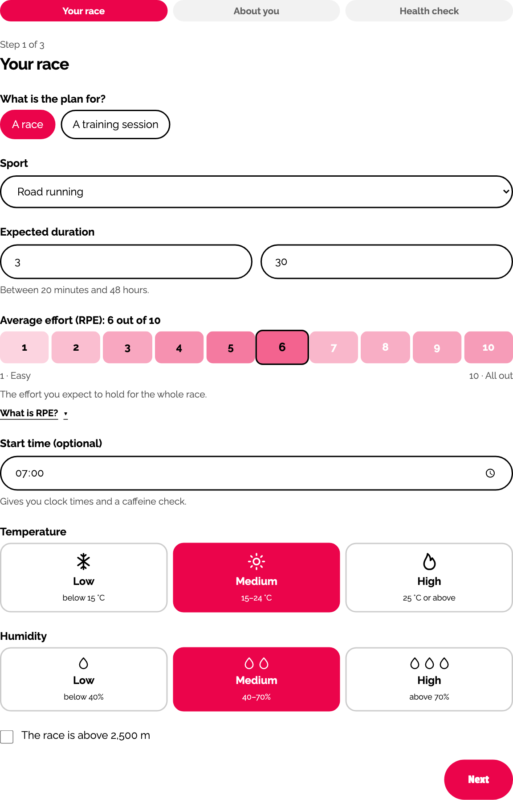
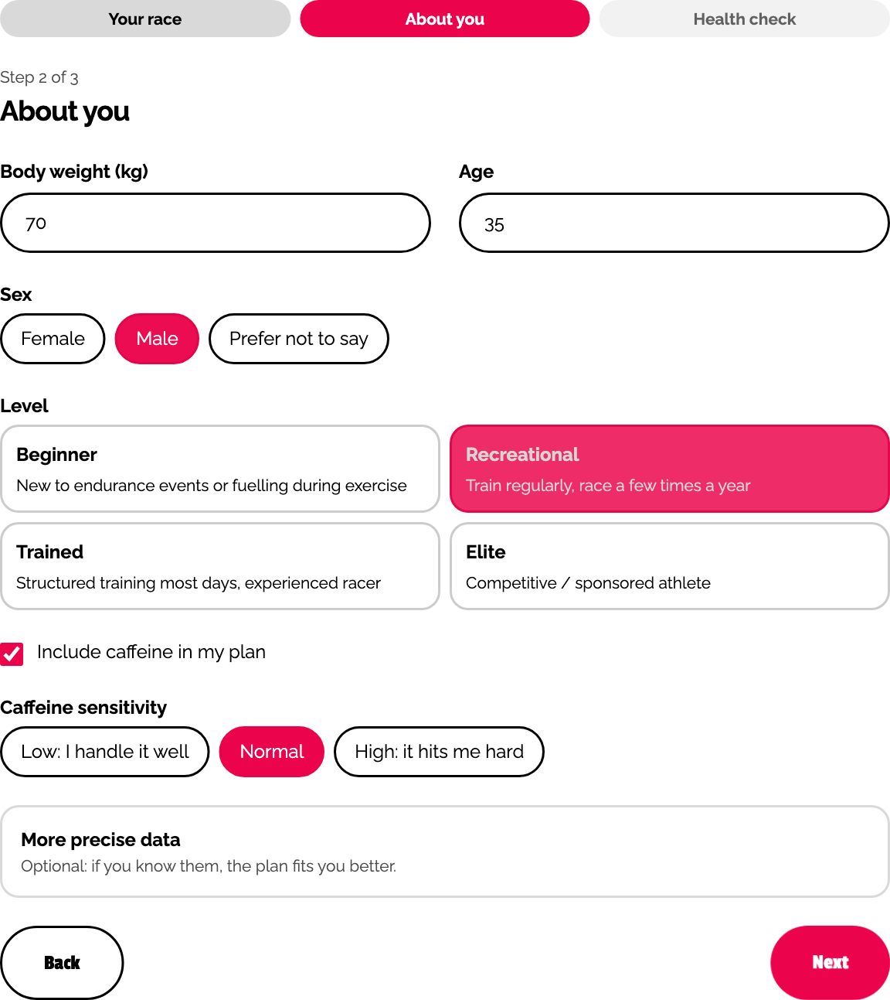
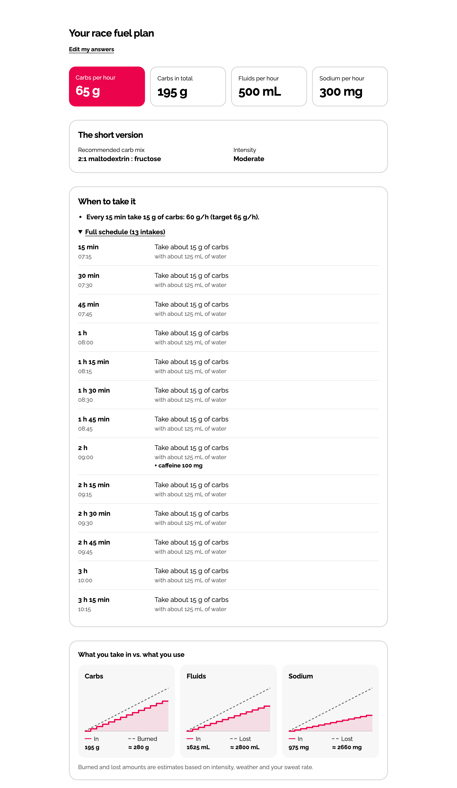
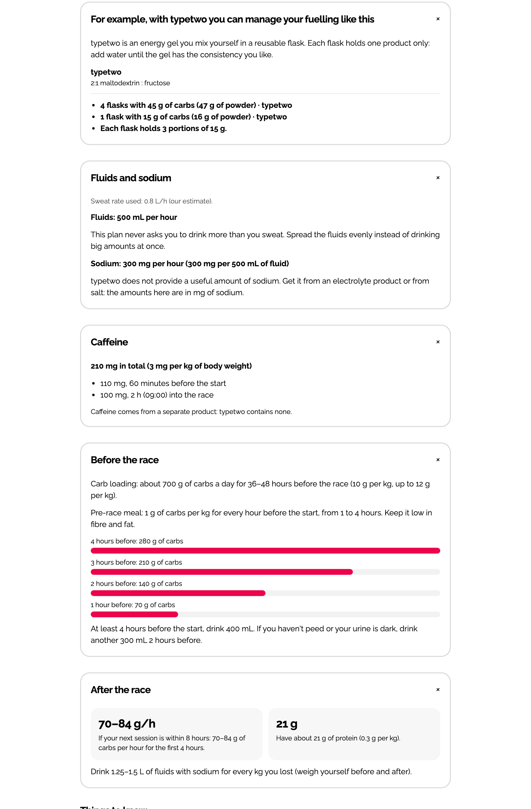

# Carbs per hour calculator

A free, open-source endurance fuelling calculator by [typetwo](https://typetwo.eu). Tell it about your race or training session and about yourself, and it builds a plan with:

- **carbs per hour** and when to take each portion
- **fluids and sodium** per hour
- **caffeine** dose and timing
- pre-race and recovery guidance
- warnings for heat, altitude, gut issues and health conditions

It runs entirely in the browser. Nothing is sent anywhere or stored.

> **Not medical advice.** This is general guidance based on published sports-nutrition research. It does not replace a doctor or a registered sports dietitian. People with diabetes, kidney or heart disease, high blood pressure, gastrointestinal conditions, or who are pregnant or on regular medication should get a plan from a professional. The calculator blocks the plan for some of these cases.

## What you get

Three short steps (the race or session, the athlete, a health check) and the plan appears on the same page. These screenshots show a 3 h 30 min road race at moderate effort, with caffeine and a 07:00 start.

<table>
  <tr>
    <td width="50%"></td>
    <td width="50%"></td>
  </tr>
  <tr>
    <td align="center">Step 1: the race or session</td>
    <td align="center">Step 2: the athlete</td>
  </tr>
</table>





### The parts of the plan

| Part | What it tells you |
| --- | --- |
| **Key numbers** | Four tiles at the top: carbs per hour, carbs in total, fluids per hour and sodium per hour. |
| **The short version** | The recommended carb mix (2:1 maltodextrin to fructose, the ratio used in the research for high carb intakes) and the intensity bucket that drove the plan. |
| **When to take it** | The rhythm (for example "every 15 min take 15 g of carbs") and the full schedule: the elapsed time, the clock time if you gave a start time, the grams of carbs and the water with each intake. Triathlon plans are split into swim, bike and run. Carbs to take before the start are listed too. |
| **Intake versus use** | Three charts of what you take in against an estimate of what you burn or lose: carbs, fluids and sodium. |
| **Product example** | How the plan translates into typetwo flasks and grams of powder. This is the only place that names a product, so it is easy to remove or replace. |
| **Fluids and sodium** | Sweat rate used (yours, or an estimate), fluids and sodium per hour, and the sodium per 500 mL. It never asks you to drink more than you sweat. |
| **Caffeine** | The total dose and when to take each part, only if you asked for it and it is safe for you. |
| **Before the race** | Carb loading or the 24 h fuel-up, the pre-race meal for 1 to 4 hours before the start, and the fluids to drink beforehand. Races only, a training session gets the meal and the fluids. |
| **After the race** | Carbs per hour and protein for recovery, and the fluids to drink for every kg lost. |
| **Things to know** | The warnings that apply to your answers, grouped by severity (see below). |
| **Important** | The medical disclaimer, always shown. |

If the health check shows a condition that needs a professional, the plan is replaced by a block message and none of the numbers above are shown.

## How it works

The calculator is a deterministic rule engine, not a model: the same answers always give the same plan. It runs in four steps.

1. **Validate.** The answers are checked against fixed ranges (`parseFuelPlanInput`). Invalid or missing required answers never reach the engine.
2. **Medical check.** If the athlete reports diabetes on medication, kidney disease or a heart condition, no plan is produced. The result is a block message that sends them to a professional.
3. **Compute.** The engine works out each part of the plan:
   - **Carbs per hour.** The starting point is a table of base values by duration and effort (below 45 min: none; 75–120 min: 30 to 60 g/h; 3–6 h: 60 to 90 g/h; over 6 h: 50 to 70 g/h). Effort comes from the RPE, grouped into low (1–4), moderate (5–6) and high (7–10); above 6 h, high counts as moderate. The base is then scaled by sport (running 0.85, trail/ultra 0.9, cycling, swimming and triathlon 1.0) and reduced by 10% under 60 kg, by 10 to 20% for moderate or severe gut issues, and by a further 10% in the heat (25 °C or more) when gut issues are present. The result is capped at 90 g/h (60 g/h for beginners and for fructose intolerance, and 10 g/h above the athlete's stated tolerance). Only a gut-trained athlete who declares a tolerance above the cap, in a race of 2.5 h or more at moderate or high effort, can go up to 120 g/h. The result is rounded to 5 g.
   - **Schedule.** The target becomes a fixed rhythm: an intake every 15 or 20 minutes (30 in swimming), in portions that fill flasks of up to 60 g of carbs, with 20 g to take 10–15 minutes before the start. Triathlon plans are split into swim, bike and run, with the run target at 85% of the bike. The plan lists every intake, with its time and the water to take with it.
   - **Fluids.** The sweat rate is the one the athlete entered, or an estimate from effort, temperature, humidity and body weight (0.3 to 2 L/h). The plan replaces the sweat rate minus an allowed deficit of 1.5% of body weight, capped at 0.6 to 1 L/h depending on the case, so the athlete never drinks more than they sweat.
   - **Sodium.** From 2 h onwards, 60% of the sodium lost in sweat is replaced: 950 mg/L by default, 1,300 mg/L for salty sweaters, or the measured value. Above 4 h there is a floor of 300 mg/h.
   - **Caffeine.** Only if the athlete asks for it, and never for under 18s, pregnancy or high blood pressure. The total is 2, 3 or 4.5 mg/kg for high, normal or low sensitivity (maximum 6 mg/kg and 400 mg). Short efforts get one dose 60 minutes before the start; longer ones get half before the start and the rest spread over the race, on the nearest planned intakes.
   - **Before and after.** For races over 90 minutes, carb loading of 10 g/kg a day, otherwise a 24 h fuel-up of 7 g/kg. A pre-race meal of 1 to 4 g/kg for the 1 to 4 hours before, with 6 and 4 mL/kg of fluid 4 and 2 hours before. Recovery is 1 to 1.2 g/kg of carbs per hour and 0.3 g/kg of protein.
4. **Warn.** Based on the answers, the plan lists the relevant warnings (for example heat, altitude, estimated sweat rate, hyponatremia risk, NSAIDs, RED-S signs, a stomach floor applied, late caffeine, too many flasks). Each one is classed as a block, a warning or an info note.

All the numbers are in `src/core/constants.ts`. Some are rules of thumb built on the published research and are marked `[heuristic]` there.

### What the calculator takes into account

#### About the race or training session

| Input | Required | How it is used |
| --- | --- | --- |
| Race or training | yes | Training uses a starting RPE by session type (easy, long, tempo, intervals, brick). Pre-race loading is shown only for races. |
| Sport | yes | Road running, track, trail/ultra, obstacle course racing, triathlon, cycling or swimming. Sets the carb factor and the intake rhythm. |
| Duration | yes | 20 minutes to 48 hours. For triathlon, the swim, bike and run times, which are summed. |
| Effort (RPE) | yes | 1 to 10. Sets the intensity bucket, hence the carb target and the sweat rate. |
| Temperature and humidity | yes | Low, medium or high. Change the sweat rate and add heat warnings. |
| Altitude above 2,500 m | no | Adds a warning. |
| Start time | no | Gives clock times and checks for late caffeine. |

#### About the athlete

| Input | Required | How it is used |
| --- | --- | --- |
| Body weight | yes | 35 to 150 kg. Scales the sweat rate, caffeine, pre-race and recovery amounts. Under 60 kg lowers the carb target. |
| Age | yes | 16 to 90. Under 18 gets no caffeine; 65 and over gets a warning. |
| Sex | yes | Used only for the risk of low blood sodium (hyponatremia) in long races. |
| Level | yes | Beginner, recreational, trained or elite. Beginners are capped at 60 g/h. |
| Caffeine and sensitivity | no | Whether to include caffeine, and the dose per kg (low, normal or high sensitivity). |
| Tolerated carbs (g/h) | no | Caps the target at this value plus 10, or raises it above 90 g/h if the athlete is gut-trained. |
| Gut-trained | no | Needed, together with a tolerance, to go above 90 g/h. |
| Gut issues history | no | None, mild, moderate or severe. Lowers the target by up to 20%. |
| Sweat rate and sweat sodium | no | If known, they replace the estimates. |
| Salty sweater | no | Raises the default sodium concentration. |

#### Health check

| Input | Effect |
| --- | --- |
| Diabetes on medication, kidney disease, heart condition | The plan is blocked. |
| Pregnancy, high blood pressure | No caffeine, plus a warning. |
| IBD/IBS | Gut history counts as at least moderate. |
| Fructose intolerance | Carbs capped at 60 g/h, plus a warning. |
| Regular NSAIDs | Higher hyponatremia risk in long races, plus a warning. |
| Signs of RED-S | Warning. |

### What it does not take into account

It does not know about training history, the course profile, nutrition from food during the race, individual medical details beyond the questions above, or how your gut reacts to a specific product. Treat the plan as a starting point and test it in training.

## Run it

```bash
npm install
npm run dev
```

Build a static site into `dist/` (it works from any path, for example GitHub Pages):

```bash
npm run build
```

## How it is organised

```text
src/core/       the calculation engine: pure TypeScript, no React, fully tested
src/ui/         the three-step form and the result page (React + Tailwind)
src/messages/   all user-facing text (English)
```

You can use `src/core/` on its own:

```ts
import { buildFuelPlan, parseFuelPlanInput } from "./src/core";

const parsed = parseFuelPlanInput({
  sport: "road_running",
  durationMin: 210,
  rpe: 6,
  weightKg: 70,
  sex: "male",
  age: 35,
  level: "recreational",
  tempC: 18,
  humidityPct: 50,
});
if (parsed.ok) {
  const plan = buildFuelPlan(parsed.input); // same input, same plan
}
```

## Where the numbers come from

The plan follows published sports-nutrition guidelines. The exact numbers are our own rules of thumb built on them, so test everything in training.

- **Carbohydrates during exercise**: Jeukendrup 2014, *Sports Med* 44(S1):S25–33. Thomas, Erdman & Burke 2016, *Med Sci Sports Exerc* 48(3):543–568. Morton et al. 2026, *J Nutr* 156(5):101442. Smith et al. 2013, *Med Sci Sports Exerc* 45(2):336–341. Podlogar et al. 2022, *Eur J Appl Physiol*. Rowlands et al. 2015, *Sports Med* 45:1561–1576.
- **Ultra-endurance**: Tiller et al. 2019, *J Int Soc Sports Nutr* 16:50.
- **The gut**: Costa et al. 2017, *Aliment Pharmacol Ther* 46:246–265. Martinez et al. 2023, *Sports Med* 53(6):1175–1200. Sports Dietitians Australia / Ultra Sports Science Foundation 2025, *Sports Med*.
- **Fluids and sodium**: Sawka et al. 2007, *Med Sci Sports Exerc* 39(2):377–390. Hew-Butler et al. 2015, *Clin J Sport Med* 25(4):303–320. Barnes et al. 2019, *J Sports Sci* 37(20):2356–2366. Baker 2017, *Sports Med* 47(S1):111–128. Baker et al. 2022, *J Appl Physiol*. McCubbin et al. 2020, *IJSNEM* 30(1):83–98. McCubbin 2025, *Performance Nutrition* 1:11.
- **Before and after the race**: Burke et al. 2011, *J Sports Sci* 29(S1):S17–27.
- **Caffeine**: Guest et al. 2021, *J Int Soc Sports Nutr* 18:1.
- **Safety**: Mountjoy et al. 2023, *Br J Sports Med* 57:1073–1097 (RED-S). Riddell et al. 2017, *Lancet Diabetes Endocrinol* 5(5):377–390 (type 1 diabetes, cited only as the reason for the block).

## Also open source

- Carb loading calculator: the days-before-the-race plan, day by day, with foods and portions (`carb-loading-calculator`).

## Contributing

See [CONTRIBUTING.md](CONTRIBUTING.md).

## License

[MIT](LICENSE). The typetwo name and logo are trademarks of typetwo and are not covered by the license.

The example in the plan that mentions typetwo flasks and powder is specific to typetwo products. Remove or adapt `typetwo` in `src/core/` and `src/messages/en.json` if you reuse the engine with other products.
